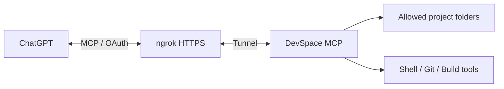

<p align="center">
  
</p>

<h1 align="center">DevSpace MCP Launcher for Windows</h1>

<p align="center">
  Дайте вашему чату в браузере доступ к папке на компьютере, больше не нужно вручную заменять файлы на пк и отправлять их в чат на редактирование, теперь все автоматически с помощью DevSpace MCP! 
  Этот лаунчер автоматически установит все зависимости для запуска DevSpace MCP (агентные навыки через плагин) + ngrok (туннелирование mcp в интернет) для ChatGPT на Windows.
</p>

<p align="center">
  
  
  
  
</p>

---

> [!NOTE]
> Этот проект является **community launcher для оригинального DevSpace**.
>
> DevSpace создан и развивается **Waishnav**:
>
> ### [Waishnav/devspace](https://github.com/Waishnav/devspace)
>
> Launcher не является официальной частью DevSpace и не заменяет оригинальный MCP-сервер.

---

# Что это такое

**DevSpace MCP Launcher for Windows** — один Windows-скрипт, который подготавливает практически чистую систему к работе с DevSpace и ChatGPT.

Вместо ручной установки Node.js, Git Bash, ngrok, DevSpace и настройки туннеля пользователь запускает один файл и проходит пошаговый мастер.

Launcher:

```text
Windows
   │
   ▼
Проверка зависимостей
   │
   ├── WinGet
   ├── Git
   ├── Git Bash
   ├── Node.js LTS
   ├── npm / npx
   ├── ngrok
   └── DevSpace
   │
   ▼
Настройка разрешённых папок
   │
   ▼
Настройка ngrok
   │
   ▼
Запуск DevSpace MCP
   │
   ▼
ChatGPT получает доступ к выбранному проекту
```

---

# Что такое DevSpace

[DevSpace](https://github.com/Waishnav/devspace) — self-hosted MCP-сервер, позволяющий ChatGPT работать непосредственно с проектами на вашем компьютере.

После подключения ChatGPT может:

- читать файлы;
- редактировать код;
- создавать новые файлы;
- искать по проекту;
- запускать команды;
- запускать тесты и сборки;
- работать с Git;
- использовать Git worktrees;
- учитывать `AGENTS.md` и `CLAUDE.md`;
- использовать локальные skills;
- использовать поддерживаемых coding agents как subagents.

Launcher не реализует эти функции самостоятельно.

**Все MCP-возможности предоставляет DevSpace.**

Задача launcher — максимально просто и безопасно запустить DevSpace на Windows.

---

# Что автоматизирует Launcher

## Проверка Windows

Скрипт проверяет:

- PowerShell;
- Execution Policy;
- Mark of the Web;
- WinGet;
- PATH;
- необходимые системные компоненты.

Если `winget` отсутствует или работает некорректно, launcher пытается восстановить Windows Package Manager.

---

## Git и Git Bash

DevSpace на Windows требует Bash-compatible shell.

Launcher проверяет наличие:

- Git for Windows;
- `git.exe`;
- Git Bash;
- `bash.exe`;
- Mintty.

При необходимости Git устанавливается автоматически.

---

## Node.js

DevSpace требует совместимый Node.js:

```text
>=22.19 <27
```

Launcher:

- обнаруживает существующий Node;
- проверяет версию;
- проверяет LTS;
- не переустанавливает совместимую установку;
- устанавливает Node.js LTS только при необходимости.

---

## ngrok

Launcher автоматически:

- обнаруживает установленный ngrok;
- проверяет версию;
- устанавливает ngrok из официального ZIP;
- использует Microsoft Store только как резервный способ;
- позволяет использовать фиксированный Dev Domain;
- позволяет использовать временный ngrok URL;
- сохраняет Authtoken;
- проверяет конфигурацию;
- запускает HTTPS tunnel;
- показывает понятную диагностику ошибок ngrok.

---

## DevSpace

Launcher:

- проверяет установленный `@waishnav/devspace`;
- сравнивает его с актуальной npm-версией;
- устанавливает или обновляет DevSpace;
- запускает `devspace doctor`;
- записывает `publicBaseUrl`;
- запускает `devspace serve`;
- позволяет открыть штатный `devspace init --force`.

---

# Идемпотентность

Launcher не пытается переустанавливать всё при каждом запуске.

Если компонент уже установлен и совместим:

```text
Git      ✓
Git Bash ✓
Node.js  ✓
npm      ✓
ngrok    ✓
DevSpace ✓
```

он просто используется.

Это позволяет запускать один и тот же файл как:

- первоначальный installer;
- launcher;
- configuration manager;
- diagnostic utility.

---

# Быстрый старт

## 1. Скачайте launcher

Скачайте последний release:

```text
start-devspace-mcp.cmd
```

из раздела **Releases** этого репозитория.

---

## 2. Запустите файл

Дважды щёлкните:

```text
start-devspace-mcp.cmd
```

Launcher автоматически начнёт проверку системы.

Если необходимые компоненты отсутствуют, они будут установлены.

<!-- SCREENSHOT 01 -->
<!--

-->

> 📷 **Скриншот для README:**  
> Добавьте сюда экран первоначальной проверки Git / Node.js / ngrok / DevSpace.  
> Рекомендуемое имя: `docs/screenshots/01-components-check.png`

---

# Главное меню

После проверки появится главное меню.

Основной пункт:

```text
[1] Запустить MCP сервер и дать ChatGPT доступ к папке
```

Также доступны:

```text
[2] Штатные настройки DevSpace
[3] Диагностика DevSpace
[0] Выход
```

<!-- SCREENSHOT 02 -->
<!--

-->

> 📷 **Скриншот для README:**  
> Главное меню launcher после успешной проверки компонентов.  
> Рекомендуемое имя: `docs/screenshots/02-main-menu.png`

---

# Выбор разрешённой папки

Launcher обязательно показывает, к каким каталогам ChatGPT будет разрешён доступ.

Например:

```text
C:\Projects\MyApplication
```

Можно указать несколько roots:

```text
C:\Projects\App1;D:\Work\App2
```

Сохранённые значения показываются отдельно.

Нажатие `Enter` оставляет текущее сохранённое значение.

<!-- SCREENSHOT 03 -->
<!--

-->

> 📷 **Скриншот для README:**  
> Экран выбора `allowedRoots`.  
> Перед публикацией убедитесь, что путь не содержит личных данных.

---

# Режим ngrok

Можно выбрать:

```text
[1] Фиксированный Dev Domain
[2] Временный случайный URL
```

Для постоянного ChatGPT plugin рекомендуется **фиксированный Dev Domain**.

Так MCP URL не меняется при каждом запуске.

---

# Фиксированный Dev Domain

Dev Domain можно получить здесь:

```text
https://dashboard.ngrok.com/domains
```

Пример:

```text
bright-forest-panda.ngrok-free.dev
```

В DevSpace записывается:

```text
https://bright-forest-panda.ngrok-free.dev
```

А ChatGPT подключается к:

```text
https://bright-forest-panda.ngrok-free.dev/mcp
```

<!-- SCREENSHOT 04 -->
<!--

-->

> 📷 **Скриншот для README:**  
> Экран настройки фиксированного ngrok Dev Domain.  
> Используйте тестовый или замаскированный адрес.

---

# ngrok Authtoken

Authtoken можно получить:

```text
https://dashboard.ngrok.com/get-started/your-authtoken
```

Launcher сохраняет его через штатную конфигурацию ngrok.

В последующих запусках сохранённый токен отображается только частично:

```text
abcde*************************************12345
```

<!-- SCREENSHOT 05 -->
<!--

-->

> [!CAUTION]
> **Никогда не публикуйте настоящий ngrok Authtoken.**
>
> Перед созданием скриншота используйте тестовые данные или полностью закройте секрет.

---

# Запуск MCP

После настройки launcher:

1. запускает ngrok;
2. проверяет HTTPS tunnel;
3. устанавливает `publicBaseUrl`;
4. запускает `devspace doctor`;
5. запускает DevSpace MCP Server;
6. ждёт открытия порта `7676`;
7. показывает готовый MCP URL.

---

# Готово

После успешного запуска вы увидите примерно:

```text
MCP Server URL:
https://your-domain.ngrok-free.dev/mcp

Owner Password:
********************************
```

И рабочее меню сервера.

<!-- SCREENSHOT 06 -->
<!--

-->

> 📷 **Скриншот для README:**  
> Финальный экран с запущенным сервером.
>
> **Обязательно закройте Owner Password.**

---

# Подключение ChatGPT

Создайте Custom MCP server в ChatGPT.

Укажите:

```text
Name:
DevSpace

MCP Server URL:
https://your-domain.ngrok-free.dev/mcp

Authentication:
OAuth
```

После подключения появится страница авторизации DevSpace.

Введите **Owner Password**, показанный launcher.

<!-- SCREENSHOT 07 -->
<!--

-->

> 📷 **Скриншот для README:**  
> Создание Custom MCP в ChatGPT.

<!-- SCREENSHOT 08 -->
<!--

-->

> 📷 **Скриншот для README:**  
> Страница уже подключённого DevSpace plugin.

---

# Как это работает



Или проще:

```text
ChatGPT
   │
   │ HTTPS / MCP
   ▼
ngrok
   │
   │ localhost:7676
   ▼
DevSpace
   │
   ├── разрешённые файлы
   ├── Git
   ├── shell
   ├── tests
   └── build tools
```

---

# Управление запущенным сервером

После запуска launcher остаётся открытым.

Он показывает:

- MCP Server URL;
- статус DevSpace;
- статус ngrok;
- разрешённые папки;
- предупреждение о shell-доступе.

В этом же меню можно:

```text
[1] Изменить разрешённые папки и применить
[0] Остановить сервер и вернуться в главное меню
```

Если `allowedRoots` изменились, DevSpace автоматически перезапускается.

ngrok при этом может остаться активным, поэтому публичный URL не меняется.

---

# Безопасное завершение

Одна из важных функций launcher — управление временем жизни процессов.

DevSpace и ngrok привязываются к жизненному циклу launcher.

Это означает:

```text
закрыли окно launcher
        ↓
останавливается DevSpace
        ↓
останавливается ngrok
        ↓
MCP-доступ прекращён
```

То же относится к:

```text
Ctrl+C
```

и штатному пункту:

```text
[0] Остановить сервер
```

Для защиты используется Windows Job Object с поведением:

```text
KILL_ON_JOB_CLOSE
```

Цель — не оставлять DevSpace/ngrok незаметно работающими в фоне после закрытия launcher.

---

# ⚠️ Безопасность

Это наиболее важный раздел README.

DevSpace предоставляет ChatGPT доступ не просто к текстовым файлам.

Внутри разрешённого workspace ChatGPT может выполнять **shell-команды с правами текущего Windows-пользователя**.

Например:

```text
git
npm
flutter
python
PowerShell
build scripts
test runners
```

и другие доступные команды.

Поэтому:

> [!WARNING]
> Подключённый ChatGPT следует рассматривать как доверенного coding agent с локальным shell-доступом.

Рекомендуется:

- разрешать только конкретные папки проектов;
- не разрешать `C:\`;
- не разрешать весь профиль пользователя без необходимости;
- не предоставлять доступ к каталогам с секретами;
- завершать launcher, когда удалённый доступ не нужен;
- проверять важные команды;
- использовать Git для проектов.

---

# Секреты

Нельзя публиковать:

### ngrok Authtoken

```text
<SECRET>
```

### DevSpace Owner Password

```text
~/.devspace/auth.json
```

### OAuth state / database

DevSpace также хранит локальное состояние авторизации.

Не добавляйте рабочие конфигурационные файлы DevSpace в репозиторий.

---

# Логи

Launcher создаёт диагностические журналы:

```text
logs/
```

Они помогают разбирать:

- установки;
- WinGet;
- npm;
- DevSpace;
- ngrok;
- tunnel errors.

> [!CAUTION]
> Перед публикацией логов обязательно проверьте их на наличие:
>
> - токенов;
> - Owner Password;
> - локальных путей;
> - имени Windows-пользователя;
> - публичных доменов;
> - другой приватной информации.

---

# Несколько компьютеров

Для каждого компьютера рекомендуется создать **свой Custom MCP plugin**.

Например:

```text
DevSpacePC
    ↓
настольный компьютер

DevSpaceLaptop
    ↓
ноутбук
```

Это проще и безопаснее, чем переносить OAuth-состояние DevSpace между устройствами.

Каждое устройство может иметь:

- свой Dev Domain;
- свой Owner Password;
- свои `allowedRoots`;
- свой OAuth connection;
- свой lifecycle launcher.

---

# ERR_NGROK_9040

Если появляется:

```text
ERR_NGROK_9040
```

ngrok блокирует подключение с текущего исходящего IP.

Если используется VPN, первым делом проверьте его режим.

Для некоторых VPN необходимо использовать:

```text
Tunnel
TUN
Full VPN
```

а не:

```text
System Proxy
Proxy mode
```

После переключения режима VPN повторите запуск.

Документация:

```text
https://ngrok.com/docs/errors/err_ngrok_9040
```

---

# Если WinGet не работает

Launcher умеет выполнять несколько уровней восстановления Windows Package Manager.

В том числе:

- обнаружение разных `winget.exe`;
- перерегистрацию Desktop App Installer;
- Reset AppX package;
- установку `Microsoft.WinGet.Client`;
- `Repair-WinGetPackageManager`.

Если WinGet восстановить невозможно, подробная ошибка остаётся в журнале.

---

# Диагностика DevSpace

В главном меню доступен:

```text
Диагностика DevSpace
```

Используется штатная команда:

```bash
devspace doctor
```

---

# Штатные настройки DevSpace

Launcher также позволяет открыть официальный setup wizard:

```bash
devspace init --force
```

Там можно изменить:

- использование с ChatGPT;
- Coding Agents;
- subagents;
- другие настройки самого DevSpace.

---

# Требования

Поддерживается:

```text
Windows 10 / 11
x64 / ARM64 — в зависимости от компонентов
Internet connection
PowerShell
```

Остальные компоненты launcher пытается установить самостоятельно.

---

# Что Launcher НЕ делает

Launcher не является:

- собственной реализацией MCP;
- форком протокола MCP;
- альтернативой DevSpace;
- облачным сервером;
- системой хранения вашего кода.

MCP-сервером является **DevSpace**.

Публичный транспорт предоставляет **ngrok**.

Launcher лишь автоматизирует их установку, конфигурацию, запуск и завершение.

---

# Upstream / Credits

## DevSpace

Оригинальный проект:

### [Waishnav/devspace](https://github.com/Waishnav/devspace)

DevSpace разработан **Waishnav**.

Все функции самого MCP-сервера, workspace tools, OAuth, subagents и интеграция с MCP предоставляются оригинальным DevSpace.

Официальная документация:

**https://devspace.run/docs**

---

## ngrok

Публичный HTTPS tunnel предоставляет:

**https://ngrok.com/**

ngrok является отдельным независимым проектом и не входит в этот repository.

---

## OpenAI / ChatGPT

Launcher позволяет настроить DevSpace как Custom MCP server для ChatGPT.

ChatGPT и OpenAI являются отдельными продуктами и не связаны с этим community-проектом.

---

# Disclaimer

Этот launcher является независимым community-проектом.

Он:

- не разработан Waishnav;
- не является официальной частью DevSpace;
- не разработан ngrok;
- не является официальным проектом OpenAI.

Названия и товарные знаки принадлежат соответствующим владельцам.

---

# License

Код самого launcher распространяется согласно лицензии, указанной в файле:

```text
LICENSE
```

DevSpace имеет собственную лицензию:

https://github.com/Waishnav/devspace/blob/main/LICENSE

Использование DevSpace регулируется лицензией оригинального проекта.

---

# Полезные ссылки

### DevSpace

https://github.com/Waishnav/devspace

### Документация DevSpace

https://devspace.run/docs

### ngrok

https://ngrok.com/

### ngrok Dev Domains

https://dashboard.ngrok.com/domains

### ngrok Authtoken

https://dashboard.ngrok.com/get-started/your-authtoken

---

# Благодарности

Большая благодарность **Waishnav** за создание DevSpace и возможность дать ChatGPT полноценный доступ к локальному development workflow через MCP.

Этот launcher существует исключительно как дополнительный Windows-инструмент, который делает первоначальную установку и повседневный запуск DevSpace проще.

---

<p align="center">
  <strong>DevSpace MCP Launcher for Windows</strong><br>
  Install → Configure → Connect → Code
</p>
